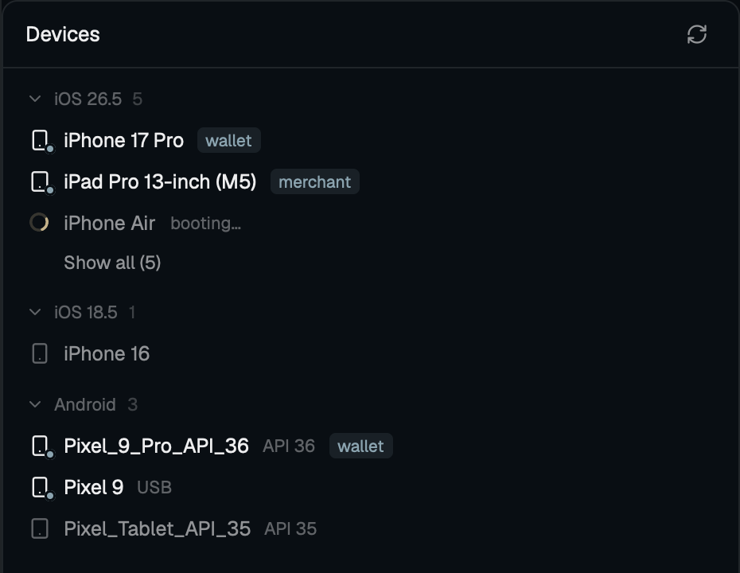

# herdr-devices

This repo is a Herdr mod plus a Claude Code plugin (the claim hook, see Claims).

Your iOS simulators, connected iPhones and Android emulators and phones in a
side panel of the [Herdr](https://herdr.dev) desktop app, most recently used
first, with the everyday actions one click away. Pick a Maestro flow from the
right-click menu and it runs on that device in a pane below.



## What you get

- iOS simulators grouped by runtime, with connected iPhones, iPads, Watches, TVs and Vision Pros under their OS version. Android AVDs and `adb` devices in one section.
- Running devices first, then the most recent. When space runs short, **Show all** reveals the older off devices.
- Each row shows the device type and its state: booted, off, booting or offline.
- A booted device shows its running app as a tag (`com.example.budget` shows `budget`).
- A second tag names who is driving it, with a link icon: an agent (`claude`, `codex`) through Maestro MCP, or `maestro` for the panel's own run. Click it to jump to that agent. Android devices are tagged only for the panel's own run.
- Live: simulator changes show within a second. Android and connected iOS devices refresh every 5 s, every 15 s once nothing has changed for half a minute.
- Under 160 px the panel becomes an icon rail.

## Actions

Hover a row for Boot or Shut down, Screenshot and More. Right-click for the full menu. Clicking a booted simulator or emulator brings its window to the front. Arrow keys, Enter, space, S and M work once the list has focus.

| Action     | Simulator                          | Android                                              |
|------------|------------------------------------|------------------------------------------------------|
| Boot       | `simctl boot`, `open -a Simulator` | `emulator -avd`, detached                            |
| Shut down  | `simctl shutdown`                  | `adb emu kill`                                       |
| Screenshot | `simctl io screenshot`             | `adb shell screencap`, `adb pull`                    |
| Copy id    | UDID                               | serial, or the AVD name when off                     |
| Open URL…  | `simctl openurl`                   | `adb shell am start -a android.intent.action.VIEW`   |
| Run Maestro flow… | `maestro --device <UDID> test <flow>` in a pane below | the same, with the serial |
| Copy app id | the running app's bundle id       | its package name                                     |
| Stop *app* | `simctl terminate`                 | `adb shell am force-stop`                            |
| Erase…     | `simctl erase`                     | wipes data and snapshots, only while off             |
| Release claim | `rm -r` of the claim folder     | the same                                             |

- **Run Maestro flow…** lists the flows in the tab's `.maestro` folder, or another folder via Browse…. Variables pass as `maestro test -e`. The last flow and its variables are remembered, and the menu offers **Run *flow* again**. Flows should launch the app themselves, since the mod only runs `maestro test`.
- **Erase…** asks first. So does a Maestro run on a device an agent has claimed.
- Connected iPhones and iPads offer only Open URL…, Run Maestro flow… and Copy UDID. Open URL opens in Safari, so custom schemes don't resolve.

Screenshots go to `~/Desktop`. An emulator started from the panel logs to `$TMPDIR/herdr-devices-<avd>.log`.

## Claims

Two agents driving one simulator trample each other. A claim says "this device is mine".

- A claim is a folder named after the device id Maestro's `--device` takes: the UDID, or the adb serial.
- It holds the agent's pid. The hook also records the agent's start time, so a reused pid doesn't count.
- The panel drops a claim once its pid is gone, and offers **Release claim** in the menu.

The row shows one pill for the agent:

| Pill | Meaning |
|------|---------|
| lock, grey | claimed, and the owner isn't driving right now |
| lock, coloured | claimed, and the owner is driving (or attached and blocked) |
| link | driven by an agent, with no claim |
| lock, then a triangle pill | claimed by one program, driven by another |

```sh
mkdir -p ~/.cache/herdr-devices/claims
mkdir ~/.cache/herdr-devices/claims/<udid> && echo $PPID > ~/.cache/herdr-devices/claims/<udid>/pid   # fails if held
rm -r ~/.cache/herdr-devices/claims/<udid>   # release
```

A plain `mkdir`, never `mkdir -p`: `-p` succeeds on an existing folder. From an agent's command shell, `$PPID` is the agent itself. An `owner` file's first line becomes the tag's label.

To claim the first free booted simulator:

```sh
for udid in $(xcrun simctl list devices booted -j | grep -o '"udid" : "[^"]*"' | cut -d'"' -f4); do
  mkdir ~/.cache/herdr-devices/claims/$udid 2>/dev/null && { echo $PPID > ~/.cache/herdr-devices/claims/$udid/pid; echo "$udid"; break; }
done
```

### Agents claim automatically

Until the panel finds the plugin (or a `claim.sh` hook), it shows an "Agents don't claim devices yet" line with **Claude Code** and **Codex** links, each copying that harness's install command, when Maestro is installed. **×** hides it for good.

Claude Code:

```sh
claude plugin install herdr-devices --marketplace ernestjsf/herdr-devices
```

The hook claims the device on any Maestro MCP call with a `device_id` that drives it (`run`; `take_screenshot` and `inspect_screen` only look, so they pass without a claim), and denies the call with a reason when another live agent holds it. It takes over a dead agent's claim and releases its own at session end.

- A denial lists the booted simulators (and Android devices, while an adb server runs) nobody has claimed, so the agent can switch to one.
- Every Maestro call by the holder, looking included, counts as use, when it starts and when it ends. A claim its live holder hasn't used for 15 minutes can be taken over by the next agent that asks. `HERDR_DEVICES_IDLE_MIN` changes the minutes. A claim made by hand never goes idle.
 The matcher also covers a Maestro server installed as a plugin (`mcp__plugin_…_maestro__…`). Web runs (`device_id: chromium`) are never claimed.

After the plugin changes, update it, then restart Claude Code:

```sh
claude plugin marketplace update herdr-devices && claude plugin update herdr-devices@herdr-devices
```

Codex:

```sh
git clone https://github.com/ernestjsf/herdr-devices ~/.codex/herdr-devices && sh ~/.codex/herdr-devices/hooks/install-codex.sh
```

The script writes `~/.codex/hooks.json` when there is none, else prints the three entries to merge into it, and never edits an existing file. Codex asks you to trust the hook: run `/hooks`. The entries it writes:

```json
{"hooks": {
  "PreToolUse": [{"matcher": "mcp__.*maestro.*", "hooks": [{"type": "command", "command": "/path/to/herdr-devices/hooks/claim.sh codex", "timeout": 10}]}],
  "PostToolUse": [{"matcher": "mcp__.*maestro.*", "hooks": [{"type": "command", "command": "/path/to/herdr-devices/hooks/claim.sh codex", "timeout": 10}]}],
  "SessionEnd": [{"hooks": [{"type": "command", "command": "/path/to/herdr-devices/hooks/claim.sh codex", "timeout": 10}]}]
}}
```

## What it runs

Only local tools, always as argument lists. It never reaches the network.

It calls `xcrun simctl`, `xcrun devicectl`, `emulator`, `adb` and `maestro`, plus `ps`, `pgrep`, `find`, `open`, `sh`, `mkdir` and `rm` for process checks, flow lists, claims and erase. Android tools are found on `PATH`, then under `$ANDROID_HOME`, `$ANDROID_SDK_ROOT` and `~/Library/Android/sdk`. It watches `~/Library/Developer/CoreSimulator` and the AVD home.

## Install

Ask your Herdr agent:

> Read ~/.config/herdr-app/AGENTS.md, then add this mod: https://github.com/ernestjsf/herdr-devices

Or copy `mods/devices/` into `~/.config/herdr-app/mods/` and run
`herdr-app check ~/.config/herdr-app/mods/devices`.

The mod docks nowhere by itself. Open it as a pane:

```sh
herdr-app do pane.split --direction right --mod devices
```

Or add a Devices button next to Files and Changes the same way
[git-graph's Graph button](https://github.com/rabeeh-ta/herdr-git-graph/blob/main/docs/top-bar.md)
is added, with `devices` in place of `graph`.

## Tests

```sh
node --test tests/
```

They cover `devices.js` (parsing and command building) and the hook scripts. The panel itself is checked with `herdr-app check mods/devices`.

## Limits

- iOS needs macOS and Xcode. The Android half should work on Linux, untested.
- A claim without a pid file stays until released from the menu.
- Clicking a booted device brings its window forward. On macOS the Simulator part needs Accessibility access for Herdr (System Settings → Privacy & Security → Accessibility); on Linux it needs `xdotool` and an X11 session (Wayland can't activate windows). Linux and Windows are untested live.
- Tested on macOS with Herdr 0.1.10. AVD erase, Android screenshots and Open URL, and connected iOS devices are covered by tests, not run live yet.

## Development

```sh
node --test tests/
```

Stdlib only. Fixtures in `tests/fixtures/` are captured tool output.
Symlinking `mods/devices` into Herdr does not hot-reload on edits; remove and
recreate the link to reload.

## License

MIT. Icons after [Lucide](https://lucide.dev) (ISC).
