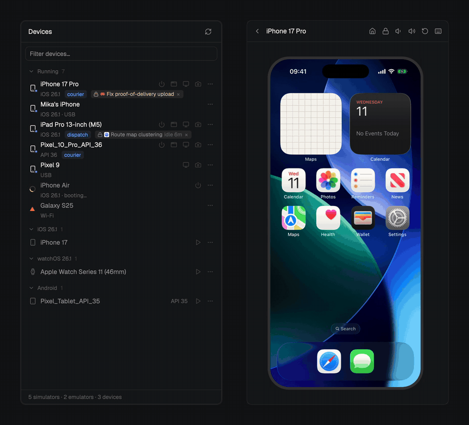
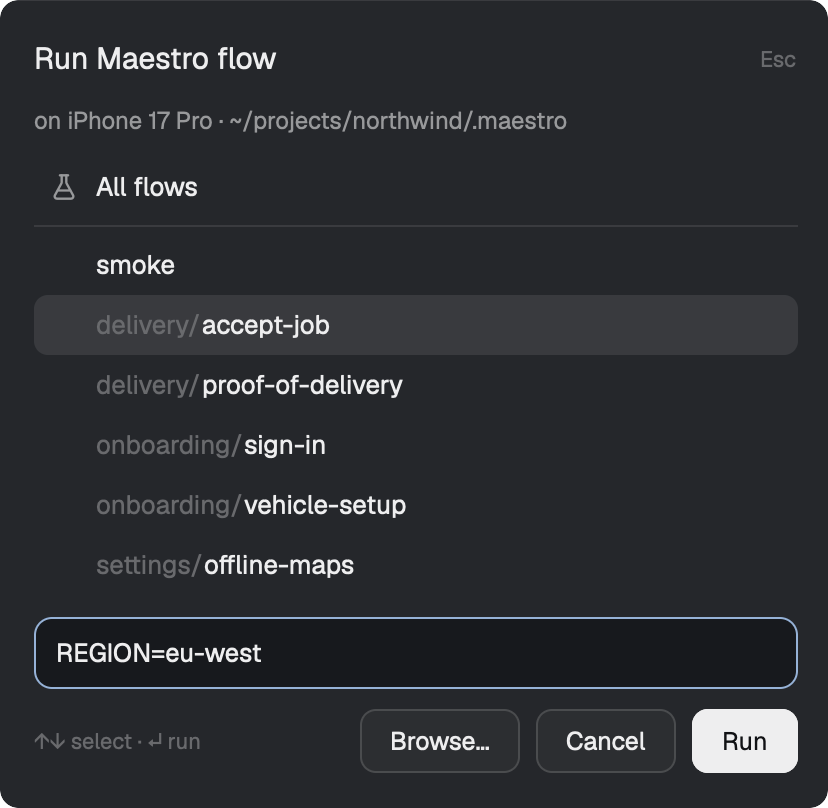
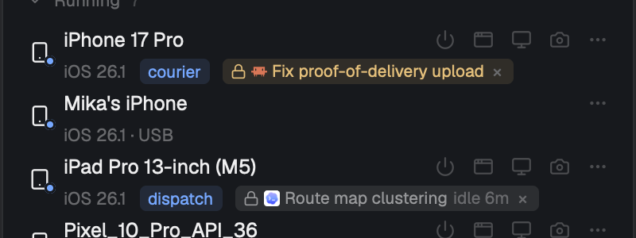
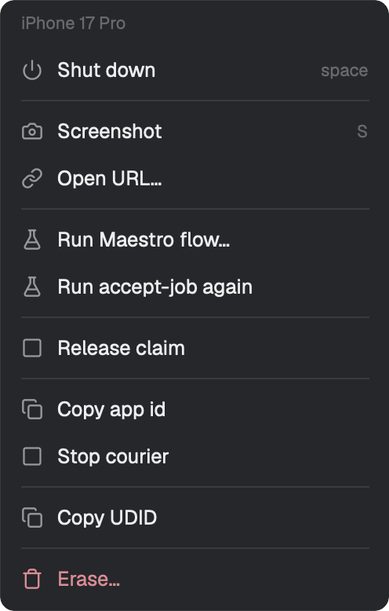

# Devices, a Herdr mod

Your iOS simulators and Android emulators in a side panel of [Herdr](https://herdr.dev), with a live screen you can tap and swipe while your agent drives the same device.



- **Every device in one list.** Simulators, emulators, and phones over USB or Wi-Fi. Running ones on top, the rest by most recent use.
- **A live screen in the panel.** Tap, swipe, scroll and type. It keeps up with a swipe.
- **Boot, shut down, screenshot, open a URL, erase.** One hover or a right-click away.
- **Run a Maestro flow** on any device, in a pane below.
- **Agents don't collide.** A device shows who is driving it, and a second agent is told to pick another.

## Install

Tell your Herdr agent:

> Read ~/.config/herdr-app/AGENTS.md, then add this mod: https://github.com/ernestjsf/herdr-devices

Or by hand:

```sh
git clone https://github.com/ernestjsf/herdr-devices
cp -R herdr-devices/mods/devices ~/.config/herdr-app/mods/
herdr-app check ~/.config/herdr-app/mods/devices
```

Then open it as a pane, or add it to your layout's side panel the way [git-graph adds its Graph button](https://github.com/rabeeh-ta/herdr-git-graph/blob/main/docs/top-bar.md), with `devices` in place of `graph`.

```sh
herdr-app do pane.split --direction right --mod devices
```

**Needs:** macOS with Xcode for iOS, the Android SDK for Android, and Node for the live screen. Each half works without the other.

## The screen

Press the monitor icon on a running device, or `V`. The screen takes the panel's place under a bar with Home, Lock, volume and Rotate. The arrow goes back.

- Click to tap, drag to swipe, scroll with the wheel, type once you've clicked the screen.
- Your agent can drive the device at the same time. The view only watches and sends your own touches.
- Simulators stream through [serve-sim](https://github.com/EvanBacon/serve-sim), which `npx` downloads on first use. Android emulators stream their own frames. Phones show about two screenshots a second.

The picture is drawn in a terminal, straight from the device, so it is on screen a few hundredths of a second after the device made it. [How it works](docs/reference.md#the-screen).

## Maestro flows



Right-click a device and choose **Run Maestro flow…**. It lists the flows in your tab's `.maestro` folder, takes variables, and runs the one you pick in a pane below. The menu then offers to run it again.

## Claims



Two agents driving one simulator trample each other. With the claim hook installed, an agent claims a device on its first Maestro call, and the next agent is refused and shown which devices are free. The row names the session holding it. Click the pill to jump there, or **×** to release it.

The panel offers to set the hook up when it's missing. Or run it yourself:

```sh
# Claude Code
claude plugin install herdr-devices --marketplace ernestjsf/herdr-devices

# Codex
git clone https://github.com/ernestjsf/herdr-devices ~/.codex/herdr-devices && sh ~/.codex/herdr-devices/hooks/install-codex.sh
```

A claim is just a folder with the agent's pid in it, so anything can make one. [How claims work](docs/claims.md).

## Actions

| Key | Does |
|---|---|
| hover | Boot or shut down, bring the window forward, show the screen, screenshot |
| right-click, `M` | The full menu |
| `space` | Boot or shut down |
| `V` | Show the screen |
| `S` | Screenshot, to `~/Desktop` |
| `Enter` | Bring the device's window forward |
| `↑` `↓` | Move through the list |

Clicking a row only selects it. Connected iPhones offer Open URL, Run Maestro flow and Copy UDID.



[What each action runs](docs/reference.md#actions).

## Good to know

- The mod runs local tools only: `simctl`, `devicectl`, `adb`, `emulator` and `maestro`. The one download is serve-sim, the first time you show a simulator's screen. [What it runs](docs/reference.md#what-it-runs).
- Show screen edits your layout file while a screen is open, and puts it back when you leave.
- Tested on macOS with Herdr 0.1.15. Linux should work for Android and is untested. [Limits](docs/reference.md#limits).
- To rebuild the mod yourself, [RECIPE.md](RECIPE.md) is the full spec.

## Credits

MIT. serve-sim and the emulator's gRPC frames are used the way [herdr-sim](https://github.com/wobsoriano/herdr-sim) does. Icons after [Lucide](https://lucide.dev) (ISC).
