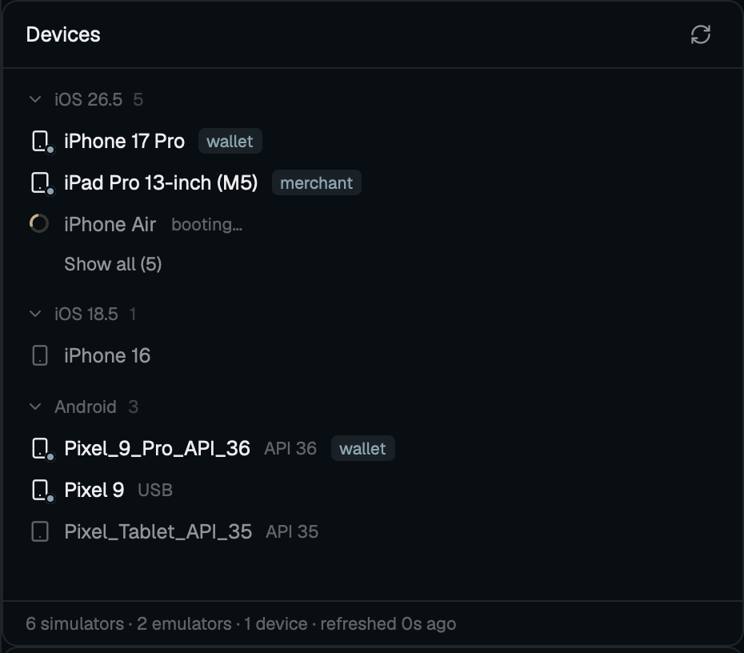

# herdr-devices

A Devices panel for the [Herdr](https://herdr.dev) desktop app: your iOS
simulators and Android emulators and phones, most recently used first, with
the everyday actions one click away.



## What you get

- **iOS** simulators grouped by runtime, **Android** AVDs and `adb` devices.
- Running devices and the three most recent per section; **Show all** for the rest.
- Each row carries its device's icon (phone, tablet, watch, TV, Vision Pro), with its state: bright with a dot when booted, dim when off, a spinner while booting or stopping, a warning triangle when offline.
- Live: simulators update within a second of a boot or shutdown from any
  terminal. Android devices are polled every 5 s; the AVD list updates when an
  AVD is added or removed.
- Devices booted from a terminal count as recent too.
- A booted device shows the app running on it as a tag after its name, the last part of its id (`com.example.budget` shows `budget`); hover for the full id. Nothing shows for an idle device. With several iOS apps running it is the one SpringBoard last put in front (from the simulator's log, read over the last 30 minutes at first); until that log says, the one using CPU most recently.
- The last list paints instantly on open. Under 160 px the panel becomes a rail.

## Actions

Click a row to boot it, or to bring Simulator to the front when it is booted.
Hover for Boot or Shut down, Screenshot and More. Right-click for the full menu.

| Action     | Simulator                          | Android                                              |
|------------|------------------------------------|------------------------------------------------------|
| Boot       | `simctl boot`, `open -a Simulator` | `emulator -avd`, detached, output to a log           |
| Shut down  | `simctl shutdown`                  | `adb emu kill`                                       |
| Screenshot | `simctl io screenshot`             | `adb shell screencap`, `adb pull`                    |
| Copy id    | UDID                               | serial, or the AVD name when off                     |
| Open URL…  | `simctl openurl`                   | `adb shell am start -a android.intent.action.VIEW`   |
| Run Maestro flow… | opens a terminal pane running `maestro --device <UDID> test <path>` | same, with the serial |
| Copy app id | the running app's bundle id       | its package name                                     |
| Stop *app* | `simctl terminate`                 | `adb shell am force-stop`                            |
| Erase…     | `simctl erase` (factory reset)     | deletes the AVD's `snapshots/`, boots it once with `emulator -wipe-data -no-snapshot -no-window`, stops it when booted |

Run Maestro flow… needs a booted device and lives in the menu only. It prefills the `.maestro` folder of the tab's terminal (its folder when there is none), and the pane stays open as a shell after the run.

Copy app id and Stop need a known app and live in the menu only; with several iOS apps running the row shows that one and the menu offers Stop for each, in the same order.
Erase lives in the menu only and asks first. An AVD is erased only while off.
Screenshots go to `~/Desktop/<device>-<YYYYMMDD-HHMMSS>-<ms>.png`.

An emulator the panel starts writes to `$TMPDIR/herdr-devices-<avd>.log`
(`~/Library/Caches/herdr-devices/` without `$TMPDIR`). If it exits before
booting, the row stops spinning after about 10 s and the log's last line is
shown.

## What it runs

Only local tools, always as argument lists: `xcrun simctl` (also `simctl spawn <udid> launchctl list` to see which apps run, and `simctl spawn <udid> log show` for the one SpringBoard put in front), `ps` (which simulator app is using CPU), `open`, `emulator`,
`adb` (also `shell dumpsys activity activities` to see the app in front), `pgrep` (is a started emulator still running), `rm` (an AVD's
`snapshots/` on erase), and `sh` to start the emulator detached with its output
in the log. It lists the AVD home (`$ANDROID_AVD_HOME`, else `~/.android/avd`)
for `<name>.ini` files, reads them, and watches it and
`~/Library/Developer/CoreSimulator`. It never reaches the network. `maestro` is started in a terminal pane via Herdr, found on your `PATH`, and is Maestro's own program, so the network claim covers the mod, not `maestro`. `adb` and `emulator` are found on `PATH`, then
under `$ANDROID_HOME`, `$ANDROID_SDK_ROOT` and `~/Library/Android/sdk`.

## Install

Ask your Herdr agent:

> Read ~/.config/herdr-app/AGENTS.md, then add this mod: https://github.com/ernestjsf/herdr-devices

Or copy `mods/devices/` into `~/.config/herdr-app/mods/` and run
`herdr-app check ~/.config/herdr-app/mods/devices`.

The mod docks nowhere by itself. Open it as a pane:

```sh
herdr-app do pane.split --direction right --mod devices
```

Or add a Devices button next to Files and Changes the same way
[git-graph's Graph button](https://github.com/rabeeh-ta/herdr-git-graph/blob/main/docs/top-bar.md)
is added, with `devices` in place of `graph`.

## Limits

- iOS needs macOS and Xcode. The Android half should work on Linux, untested.
- iOS physical devices are not listed yet.
- Clicking a booted AVD does nothing: the emulator window has no app bundle to activate.
- Tested on macOS with Herdr 0.1.10. AVD erase, and Android screenshots and
  Open URL, are covered by tests, not run live yet.

## Development

```sh
node --test tests/
```

Stdlib only. Fixtures in `tests/fixtures/` are captured tool output.
Symlinking `mods/devices` into Herdr does not hot-reload on edits; remove and
recreate the link to reload.

## License

MIT. Icons after [Lucide](https://lucide.dev) (ISC).
