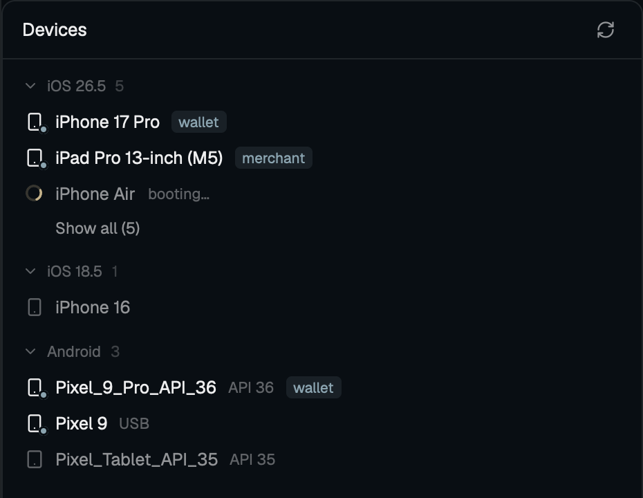

# Devices

A side panel listing the Mac's iOS simulators, grouped by runtime, and its
Android emulators and devices, each with a status dot. Hovering a row shows
small icon buttons (Boot or Shut down, Screenshot, Copy id, Open URL, Erase);
right-clicking it opens the same actions as a menu. Erase and Open URL ask in a
dialog first. It fills a side panel (a Devices button beside Files and Changes)
or a pane.

## What you see

One column on the `background` color, radius 10, 1px `border`, base type 13px
in `foreground`. Top to bottom:

- **Header**, 42px, 14px side padding, 1px `border` underneath. "Devices" at
  13px semibold on the left. On the right, while a list read or a panel action
  runs, a 14px ring spinner in `muted` (Herdr's
  `mods/workspace-chrome/spinner.svg`, `.spin(900)`), then a 24px Refresh
  button (radius 6, `hover` under the pointer) with a 14px refresh icon in
  `muted`.
- **The list**, scrolling with a scrollbar, 8px bottom padding:
  - **Section titles**, 11px semibold `dim`, 14px side padding, 12px above and
    4px below: one per simulator runtime (`iOS 26.5`; ids like
    `com.apple.CoreSimulator.SimRuntime.iOS-26-5` become `iOS 26.5`, `xrOS`
    becomes `visionOS`), iOS first then watchOS, tvOS, visionOS, newest version
    first; then `Android`.
  - **Rows**, 30px, 6px outer and 8px inner side margin, radius 7, 8px gaps,
    `hover` background under the pointer: a 7px round dot (`done` when booted or
    online, `dim` when off, `blocked` otherwise), the name (truncated; `muted`
    when off, `foreground` otherwise), and for a state that is neither on nor
    off (`offline`, `unauthorized`, `booting`) that word at 11px in `blocked` on
    the right.
  - **On hover** (panel at least 200px wide, no panel action running) the state
    word gives way to 22px icon buttons, radius 5, `raised` under the pointer,
    13px icons in `muted`; Erase's trash icon in `ansi1`. Which buttons a row
    gets, in order: Shut down (power) when on, or Boot (play) when off — for
    simulators and AVDs only; Screenshot (camera) and Open URL (link) when on;
    Copy (copy) always; Erase (trash) for every simulator and for an AVD only
    while it is off. Physical devices never get Boot, Shut down or Erase.
  - **Lines** in place of rows, 12px `dim`, 14px side padding: `Loading
    devices…` before the first read; under `iOS`, `xcrun not found`, simctl's
    error, or `No simulators installed`; under `Android`, `emulator not found`
    and/or `adb not found`, or `No emulators or devices`.

**The menu** is a 210px popup at the pointer on `popover`, 5px padding, its
height 30px per item plus 38px: a 24px line with the device's name at 11px
`dim`, then 30px rows (radius 7, 9px gap, a 14px icon in `muted`, 12.8px text),
`selected` for the keyboard choice, `hover` under the pointer. Erase is `ansi1`,
icon and text. A running item reads `Working…`.

**Dialogs** are 420px wide (Open URL 200px tall, Erase 190px) on `popover`,
18px padding, 10px gaps, like Herdr's prompt and confirm: a 15px semibold title
(`Open URL` or `Erase <name>?`) with `Esc` at 11px `dim` on the right, a `muted`
sentence, for Open URL a 36px input (radius 9, 1px `accent` border, `background`
fill, 12.8px, placeholder `https://… or myapp://…`), an error line at 12px
`ansi1` when there is one, and on the right 32px buttons (radius 8, 12.5px
medium): Cancel (`raised`, 1px `input` border) and the action — Open in
`solid` / `solid_foreground`, Erase in `ansi1` with `background` text. The
action button reads `Working…` while it runs.

## How it behaves

- Agent statuses aren't shown: this panel is about devices.
- **Reading the lists** (at start, every 5 s, after Refresh, and whenever the
  shared `devices.changed` changes), all at once: `xcrun simctl list devices
  -j`, `emulator -list-avds`, `adb devices -l`, then for each running
  `emulator-NNNN` serial `adb -s <serial> emu avd name` (first line) to name its
  AVD. A read never overlaps another.
- **The rows**: simulators with `isAvailable` true; state `Booted` is on,
  `Shutdown` off, anything else shown lowercased. Every AVD from
  `-list-avds`, on (with its serial) when a running emulator reports its name,
  else off. An emulator whose AVD isn't in the list is shown by its name or
  serial. Other adb serials are phones, named by `model:` (underscores as
  spaces) or the serial; `device` is on, any other state is shown.
- **Hover** shows a row's buttons; **right-click** opens the menu (up, down,
  enter, esc work). Clicking a button or menu item:
  - **Boot**: simulator `xcrun simctl boot <udid>` (exit 149, already booted,
    counts as success), then `open -a Simulator`; AVD `sh -c 'nohup "$1" -avd
    "$2" >/dev/null 2>&1 &' sh <emulator> <avd>`, so it starts detached.
  - **Shut down**: `xcrun simctl shutdown <udid>`; `adb -s <serial> emu kill`.
  - **Screenshot**: `xcrun simctl io <udid> screenshot <path>`; Android `adb -s
    <serial> shell screencap -p /sdcard/herdr-devices-shot.png`, `adb pull` it
    to `<path>`, `adb shell rm -f` it (that last step may fail). `<path>` is
    `~/Desktop/<name>-<YYYYMMDD-HHMMSS>.png` (name characters outside
    `[A-Za-z0-9._-]` become `-`). Toasts `Screenshot saved` with the path.
  - **Copy**: the UDID, serial, or (an off AVD) its name to the clipboard;
    toasts `Copied`.
  - **Open URL…**: the dialog; Enter or Open checks the URL has a scheme
    (`https://`, `myapp://`), then `xcrun simctl openurl <udid> <url>` or `adb
    -s <serial> shell am start -a android.intent.action.VIEW -d '<url>'` (the
    URL single-quoted for the device's shell, since `adb shell` joins its words).
  - **Erase…**: the dialog; Enter or Erase runs it. Simulator: `xcrun simctl
    shutdown` (failure ignored), then `xcrun simctl erase <udid>`. AVD: `adb
    devices -l` and the emulators' names are read again, and a running AVD is
    refused (`It's running. Shut it down first.`); otherwise its folder is the
    `path=` line of `<avd home>/<name>.ini` (avd home `$ANDROID_AVD_HOME`, else
    `~/.android/avd`), else `<avd home>/<name>.avd`, and `sh -c 'rm -rf
    "$1"/userdata-qemu.img* "$1"/snapshots' sh <folder>` deletes its data.
    Toasts `Erased <name>`.
- An action stops at its first failing command and toasts an error: `Couldn't
  boot <name>` (shut down, take a screenshot of, open the URL on, erase) with
  the first useful line of stderr, then stdout (simctl's generic `An error was
  encountered processing the command` line is skipped). A dialog keeps its
  error on screen too and stays open; on success it closes.
- While a panel button's action runs, the spinner shows and the hover buttons
  hide. After any action every copy reloads.

## Built from

- `mods/devices/`, `mod.json` `{ "place": "none", "title": "Devices" }`: it docks
  nowhere by itself.
- `main.js`: one `View` with four roles by `props().role`: none, the panel;
  `"menu"`, the popup (`openOverlay({ mod: "devices", kind: "popup", width: 210,
  height, props: { role: "menu", device } })`); `"url"` and `"erase"`, dialogs
  (`kind: "dialog", width: 420, height: 200 | 190, props: { role, device }`).
- `devices.js`, no herdr import: parsing (`parseSimctl`, `parseAvds`,
  `parseAdbDevices`, `parseEmuAvdName`, `androidDevices`, `parseAvdIni`), the
  row model `{ kind: "sim" | "avd" | "phone", id, name, state, serial?, avd? }`,
  `actionsFor(device)` (buttons and menu share it), `stepsFor(action, device,
  x)` (the argv of every action), `toolCandidates`, `errorLine`,
  `screenshotPath`, `validUrl`.
- `actions.js`: `load()` and `perform(action, device, { url })` through `exec`.
  `adb` and `emulator` are tried on PATH, then `$ANDROID_HOME`,
  `$ANDROID_SDK_ROOT` (read once with `sh -c 'printf …'`) and
  `~/Library/Android/sdk`; the first that starts is kept.
- `herdr` functions: `exec`, `home`, `readTextFile`, `notify`, `setShared` /
  `shared` (`devices.changed`), `openOverlay`, `closeOverlay`, `props`,
  `theme`. gpui-kit: `cx.write_to_clipboard`, `svg(...).spin(900)`,
  `on_hover`, `on_mouse_down("right", …)`, `on_size_change`, `InputState` +
  `Input`.
- Programs: `xcrun`, `open`, `emulator`, `adb`, `sh`, `rm`. No network.
- Icons in `icons/` after Lucide (ISC notice there): devices, refresh, play,
  power, camera, copy, link, trash.
- The top-bar button lives in clones of Herdr's `tabs` mod and `main` layout,
  as git-graph's `docs/top-bar.md` describes: `"devices"` in the enabled panels,
  a `panelButton("devices", "Devices", "mods/devices/icons/devices.svg")`, and
  a `devices` block in the `panel-body` stack.

## Watch out

- `nextCommand()` returns only the command's name, so Herdr's `confirm` and
  `prompt` mods (which `run` a command with args) can't carry a device id to
  this mod. The menu and dialogs are this mod's own roles and run the action
  themselves.
- A popup's tasks end when it closes: the menu finishes its command
  (`Working…`) before closing. Copy and the dialogs close it at once.
- `exec` returns stdout as text, so `adb exec-out screencap -p` would corrupt
  the PNG; the screenshot goes through the device's `/sdcard` and `adb pull`.
- `exec` waits for the program, and `emulator -avd` never returns: start it
  detached through `sh -c 'nohup … &'`, names as positional arguments.
- `exec` rejects when a program can't start: catch it per tool, or one missing
  SDK hides the other platform's list.
- simctl's first stderr line is a generic preamble; the reason is on line two.
- `adb shell` joins its arguments into one device-shell command line: quote
  the URL, or `&` in it splits the command.
- `cx` is only good inside its handler: write the clipboard before any `await`.
- No hover groups in gpui-kit: the row tracks `on_hover` and redraws.
- `.when(cond, …)` needs a real boolean; create focus handles and input states
  in `init`, never in `render`.
- Herdr hot-reloads on changes under `~/.config/herdr-app/mods/`. A symlinked
  mod folder is loaded and checked fine, but edits in its target don't reload
  it; re-create the link.
- `herdr-app shot` returns the last drawn frame; a window that isn't redrawing
  gives a stale one. Toggle the panel (`herdr-app do tabs-graph.devices` twice)
  before shooting.
- `done` is the theme's "finished" color, not necessarily green (a pale blue
  in graphite).
- Polls every 5 s while hidden; don't go faster.
- Untested: Android actions on a running emulator or phone, Linux, zoom other
  than 1. iOS physical devices aren't listed (v1.1, `devicectl`).

## Done when

- `node --test tests/` passes: runtime labels, the captured simctl list (one
  runtime, five simulators, two booted), unavailable simulators hidden and
  runtimes ordered, AVD names with emulator chatter, `adb devices -l` with
  emulators, a phone, offline and unauthorized rows, AVD/serial mapping, tool
  candidates, error lines, screenshot paths, the actions per row, and every
  action's argv (the URL quoted for `adb shell`, erase refusing a folder that
  isn't an absolute `*.avd`).
- `herdr-app check ~/.config/herdr-app/mods/devices` passes and `herdr-app
  status` shows `"errors": []` with the panel open.
- The panel lists the simulators under `iOS <version>` with booted ones dotted
  in `done`, and the AVDs under `Android`.
- On a throwaway simulator (`xcrun simctl create`): Boot boots it and opens
  Simulator, Boot again succeeds, Screenshot writes a PNG to the Desktop, Open
  URL opens the URL, Shut down shuts it down, Erase resets it, and Open URL on a
  shut-down simulator toasts `Unable to lookup in current state: Shutdown`.
